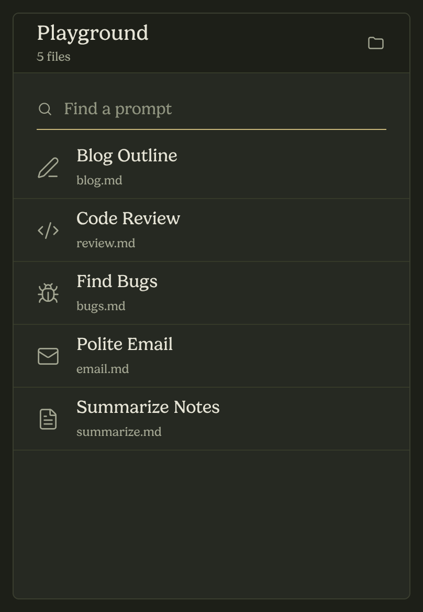

<!--
Description: Prompt Slinger is a local-first Chrome and Brave extension that injects Markdown prompts from a folder into AI chat composers.
Keywords: chrome extension, brave extension, markdown prompts, prompt manager, AI chat, ChatGPT, WXT, React, TypeScript, local-first
-->

<div align="center">


# Prompt Slinger

### Keep your prompts in Markdown. Fire them into any AI chat composer.

[](#)
[](#)
[](#)
[](#)
[](#)
[](#testing)

**Local-first · Read-only · No account · No network**

[Features](#features) · [How it works](#how-it-works) · [Getting started](#getting-started) · [Prompt format](#prompt-format) · [Troubleshooting](#troubleshooting)

</div>

---



## About

**Prompt Slinger** is a browser extension for people who keep their best prompts
as Markdown files. Pick a folder once, and the extension turns it into a fast,
searchable prompt palette inside your browser toolbar.

Click a prompt to append it to the focused composer on the current page. Your
existing text is preserved. The prompt body is added after it, followed by a
`---` separator, so you can keep typing or stack several prompts in one message.

Everything stays on your machine: the extension reads local files, stores a
snapshot in `chrome.storage.local`, and never sends prompt content anywhere.

> [!NOTE]
> The UI is a classic action popup. Folder selection happens in a short-lived
> extension tab because a native folder dialog closes the action popup and loses
> the selection. The tab closes itself after the folder is scanned.

---

## Features

| | |
| --- | --- |
| **Markdown-native** | Recursively scans a folder for `.md` files, including nested folders. |
| **Frontmatter aware** | Reads `name` (or `title`) and `icon-name`; frontmatter is never injected. |
| **Lucide icons** | Any kebab-case [Lucide](https://lucide.dev/) icon name works, with `file-text` as fallback. |
| **Instant search** | Filters by prompt name or filename as you type. |
| **One-click injection** | Appends the prompt to the focused `textarea`, input, or `contenteditable` composer. |
| **Local snapshot** | Prompts are cached in `chrome.storage.local`, so the popup opens instantly. |
| **Self-healing** | Re-injects the content script automatically after an extension reload. |
| **Privacy by design** | Read-only file access, no telemetry, no remote requests, no accounts. |

### Safe scanning

- Scans up to **2,000** Markdown files.
- Descends at most **16** folder levels.
- Skips hidden files and folders (names starting with `.`).
- Skips unreadable files instead of failing the whole scan.

---

## How it works

```text
┌─────────────────────┐
│  Markdown folder    │
│  prompts/*.md       │
└──────────┬──────────┘
           │ recursive scan
           ▼
┌─────────────────────┐       ┌──────────────────────────┐
│  Parser             │       │  chrome.storage.local    │
│  name / title       │──────▶│  snapshot of all prompts │
│  icon-name / body   │       └────────────┬─────────────┘
└─────────────────────┘                    │
                                           ▼
                                  ┌──────────────────┐
                                  │  Toolbar popup   │
                                  │  search + list   │
                                  └────────┬─────────┘
                                           │ click a prompt
                                           ▼
                                  ┌──────────────────┐
                                  │  Content script  │
                                  │  active composer │
                                  └──────────────────┘
```

1. Click the toolbar icon to open the popup.
2. Click the folder button. A small extension tab opens the native folder picker.
3. Pick a folder. Markdown files are parsed and saved as a snapshot.
4. Search or click a prompt. The popup messages the content script in the active tab.
5. The content script finds the focused (or best visible) composer and inserts:

   ```text
   <existing text>
   <prompt body>
   ---
   ```

6. The popup closes after the page acknowledges the insertion.

---

## Getting started

### Prerequisites

- **Bun** 1.x (recommended; the lockfile is `bun.lock`)
- **Chrome** or **Brave** with extension developer mode enabled

### Install dependencies

```bash
bun install
```

### Development

```bash
bun run dev
```

WXT opens a browser with the extension loaded and reloads it on changes.

### Production build

```bash
bun run build
```

The unpacked extension is written to:

```text
.output/chrome-mv3/
```

### Load the extension

1. Open `chrome://extensions` or `brave://extensions`.
2. Enable **Developer mode**.
3. Click **Load unpacked**.
4. Select `.output/chrome-mv3`.
5. Pin **Prompt Slinger** to the toolbar.

After rebuilding, click **Reload** on the extension card. The content script
reconnects automatically on the next injection, even in already-open tabs.

### Scripts

| Command | Purpose |
| --- | --- |
| `bun run dev` | Start WXT in development mode |
| `bun run build` | Build the Chrome MV3 extension |
| `bun run compile` | Type-check with `tsc --noEmit` |
| `bun run test` | Run the Vitest suite |
| `bun run zip` | Package the built extension |

---

## Prompt format

A prompt is a Markdown file with optional YAML frontmatter:

```markdown
---
name: Clean LLM Response
icon-name: bot-message-square
---

Prefer direct answers over long explanations.

- Keep each bullet under 20 words.
- Use at most five bullets per section.
- Expand only when the user asks.
```

### Frontmatter fields

| Field | Required | Behavior |
| --- | --- | --- |
| `name` | No | Display name. Falls back to `title`, then the filename without `.md`. |
| `title` | No | Alias for `name`, useful for Obsidian properties. |
| `icon-name` | No | Kebab-case Lucide icon. Defaults to `file-text`. |

The body is everything after the closing `---`, trimmed at both ends.
Frontmatter is **never** injected into the composer.

### Suggested folder layout

```text
my-prompts/
├── clean-llm-response.md
├── code-review.md
└── Writing/
    ├── blog-outline.md
    └── polite-email.md
```

---

## Usage

1. Open any AI chat (for example `chatgpt.com`).
2. Click into the message composer.
3. Open Prompt Slinger and search for a prompt.
4. Click the prompt.
5. The body is appended to your existing text, followed by `---`.

If no composer is focused, the content script picks the best visible editable
element near the bottom center of the page.

### Supported composers

- `<textarea>`
- Text inputs (`type="text"`, `"search"`, `"url"`)
- `contenteditable` elements, including `role="textbox"`

ChatGPT's composer is supported and used as the primary test target.

---

## Project structure

```text
prompt-slinger/
├── src/
│   ├── entrypoints/
│   │   ├── background.ts        # Extension service worker
│   │   ├── content.ts           # Content script wiring
│   │   ├── picker/              # Folder-picker extension tab
│   │   └── popup/               # Classic action popup
│   ├── features/prompts/
│   │   ├── prompts.content.ts   # Composer detection and insertion
│   │   ├── prompts.files.ts     # Folder scan and snapshot building
│   │   ├── prompts.parse.ts     # Frontmatter parsing
│   │   ├── prompts.storage.ts   # Snapshot + handle persistence
│   │   ├── prompts.ui.tsx       # Design-faithful popup view
│   │   └── prompts.use.ts       # Popup state and injection flow
│   └── shared/                  # Shared types and utilities
├── public/
│   ├── design/Popup.html        # Visual source of truth
│   ├── fonts/                   # Gelica
│   └── icon/                    # Extension icons + SVG source
├── docs/superpowers/            # Specs and implementation plans
└── wxt.config.ts                # WXT + manifest configuration
```

### Permissions

| Permission | Why |
| --- | --- |
| `storage` | Cache the prompt snapshot locally. |
| `scripting` | Reconnect the content script after an extension reload. |
| `<all_urls>` | Inject prompts into composers on AI chat sites. |

---

## Testing

```bash
bun run test
bun run compile
bun run build
```

The suite covers parsing, scanning, filtering, icons, storage, popup state, and
the content-script insertion behavior.

Current status: **48 tests passing**.

---

## Troubleshooting

<details>
<summary><b>“Can’t inject on this page.”</b></summary>

The active tab has no reachable content script, or it is not an editable page.

- The extension now retries with a fresh content script automatically.
- If it still fails, refresh the page once, then try again.
- Make sure the page URL is not a browser-internal page (`chrome://`, `brave://`,
  the Web Store, etc.), where extensions cannot inject scripts.
</details>

<details>
<summary><b>“No editable input found on this page.”</b></summary>

Click directly inside the chat composer first, then click the prompt. If the site
uses a custom editor, make sure it exposes a `textarea`, text input, or
`contenteditable` element.
</details>

<details>
<summary><b>Prompts are missing or names look wrong</b></summary>

Re-select the folder from the popup. The saved snapshot is only rebuilt when a
folder is chosen; editing files on disk does not update it automatically.

Use `name:` or `title:` in frontmatter for the display name.
</details>

<details>
<summary><b>The toolbar icon did not update</b></summary>

Go to the extensions page, click **Reload** on Prompt Slinger, then reopen the
popup. Browsers cache extension icons aggressively.
</details>

---

## Contributing

1. Fork the repository.
2. Create a branch: `git checkout -b feature/my-change`.
3. Make the change and add tests.
4. Run `bun run test`, `bun run compile`, and `bun run build`.
5. Open a pull request.

Please keep the popup visually aligned with `public/design/Popup.html` and keep
the extension local-first: no telemetry, no remote API calls, no writing to the
prompt folder.

---

## License

No license file has been added to this repository yet. Until one is added, all
rights are reserved.
